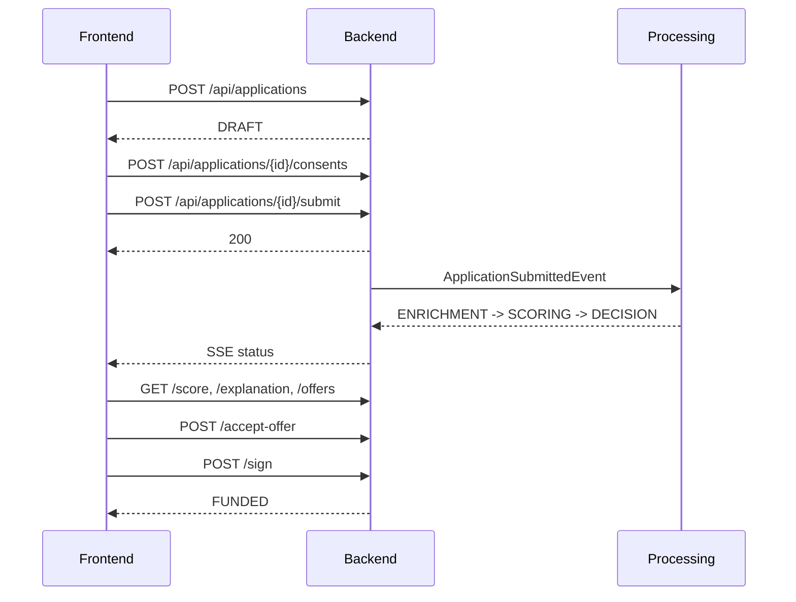

# Backend для фронтенда

Этот документ описывает backend глазами фронтенд-разработчика: какие экраны можно собрать,
какие эндпоинты вызывать, какие статусы показывать и какие ограничения сейчас есть.

## 1. Коротко

- Base URL локально: `http://localhost:8080`
- Swagger UI: `http://localhost:8080/swagger-ui.html`
- OpenAPI JSON: `http://localhost:8080/v3/api-docs`
- Авторизация: HTTP Basic Auth
- Формат данных: JSON, кроме загрузки документов (`multipart/form-data`)
- Время: ISO-8601 UTC, например `2026-10-24T01:00:00Z`
- Деньги: JSON-число, например `3000000`
- ID: UUID-строки

Демо-пользователи:

| Логин | Пароль | Роль | Что доступно |
|---|---|---|---|
| `client` | `password` | CLIENT | Свои заявки, согласия, офферы, подписание |
| `manager` | `password` | MANAGER | Все заявки, ручные решения, DLQ |

## 2. Что нужно создать на фронтенде

### Клиентский кабинет

1. **Экран входа / демо-авторизации** — Basic Auth, выбор роли `client`.
2. **Дашборд заявок** — список своих заявок, статусы, суммы, дата обновления.
3. **Квиз / подбор продукта** — цель, сумма, срок; рекомендации продуктов.
4. **Предодобренное предложение** — проверка по ИНН, сумма, срок, ставка, платёж.
5. **Мастер создания заявки** — компания, продукт, сумма, срок, залог, цель.
6. **Согласия** — обязательное подписание БКИ и ПДн перед отправкой.
7. **Трекер заявки** — текущий статус, timeline, SSE-обновления, score.
8. **Экран решения** — одобрено / контрпредложение / отказ, факторы и объяснение.
9. **Сравнение офферов** — сумма, срок, ставка, ежемесячный платёж, переплата.
10. **Принятие оффера и подписание** — `SIGNING -> FUNDED`.
11. **Загрузка документов** — если менеджер запросил документы (`NEEDS_MORE_INFO`).

### Кабинет менеджера

1. **Очередь ручного рассмотрения** — заявки в `MANUAL_REVIEW`.
2. **Карточка заявки менеджера** — сумма, score, grade, причины, timeline.
3. **Форма решения** — `APPROVE`, `COUNTER_OFFER`, `REQUEST_DOCS`, `REJECT`.
4. **DLQ-экран** — заявки с ошибкой обработки, количество попыток, последняя ошибка, кнопка retry.

### Общие компоненты

- Обработка `401`, `403`, `404`, `409`, `429`, `500`.
- Loading / empty / error states.
- Polling или SSE для промежуточных статусов.
- Форматирование денег и дат.
- Guard по роли: менеджерские разделы не показывать клиенту.

## 3. Авторизация

Используется HTTP Basic Auth. На каждый запрос:

```http
Authorization: Basic base64(client:password)
```

В браузере:

```js
const auth = btoa(`${username}:${password}`);
fetch(`${BASE_URL}/api/applications`, {
  headers: {
    Authorization: `Basic ${auth}`,
    "Content-Type": "application/json"
  }
});
```

Особенности:

- Нет endpoint'а логина, refresh-токена и профиля пользователя.
- Роль определяется логином: `client` или `manager`.
- Клиент видит только свои заявки. Менеджер видит все.
- Для Swagger UI используйте кнопку **Authorize**. Одновременно можно держать только одни credentials; для смены роли нажмите **Logout** и авторизуйтесь заново.
- В реальном фронтенде не храните пароль в `localStorage`; это демо-кейс. Для production нужен нормальный token flow.

## 4. Общие соглашения

### Пагинация

Все списочные эндпоинты принимают:

```http
?page=0&size=20
```

- `page` — с нуля;
- `size` — от 1 до 100, по умолчанию 20;
- ответ всегда имеет форму:

```json
{
  "items": [],
  "page": 0,
  "size": 20,
  "totalItems": 0,
  "totalPages": 0
}
```

### Ошибки

Успешные ответы — обычный JSON. Ошибки приложения — JSON:

```json
{
  "error": "Заявка не найдена",
  "code": "NOT_FOUND"
}
```

Ориентируйтесь на `code`, а не на текст `error`: текст может меняться.

Основные коды:

| HTTP | code | Когда |
|---|---|---|
| `400` | `BAD_REQUEST` | Некорректный JSON, сумма/срок вне лимитов продукта, неверный тип файла |
| `400` | `FILE_TOO_LARGE` | Файл больше 10 МБ |
| `400` | `INVALID_MULTIPART` | Загрузка документа не как `multipart/form-data` |
| `401` | — | Нет или неверные Basic Auth credentials |
| `403` | `FORBIDDEN` | Нет доступа к чужой заявке или менеджерскому разделу |
| `404` | `NOT_FOUND` | Заявка, компания, продукт, оффер или задача не найдены |
| `409` | `INVALID_STATE_TRANSITION` | Действие невозможно в текущем статусе |
| `409` | `ILLEGAL_STATE` | Операция невозможна, например скоринг ещё не выполнен |
| `409` | `CONFLICT` | Заявку уже изменил другой пользователь, обновите данные |
| `429` | — | Превышен rate limit |
| `500` | `INTERNAL_ERROR` | Внутренняя ошибка |

Отдельно:

- Дубликат `Idempotency-Key` возвращает `409` с **текстом**, а не JSON.
- Rate limit возвращает `429` с текстом `Too many requests. Please try again later.`
- `401` от Basic Auth может прийти без JSON-тела.

### Идемпотентность

Для POST-запросов под `/api/applications` можно передавать:

```http
Idempotency-Key: <uuid>
```

Поведение:

- ключ хранится в Redis 24 часа;
- повторный запрос с тем же ключом получает `409` и текст `Duplicate request detected. Please wait.`;
- исходный успешный ответ не кэшируется и не возвращается повторно;
- если запрос завершился ошибкой, ключ удаляется;
- используйте уникальный ключ на каждое пользовательское действие, а не один ключ на всю сессию.

Практический сценарий: сгенерировали ключ перед созданием заявки, отправили запрос. Если сеть оборвалась и вы не знаете, создалась ли заявка, повторите с тем же ключом. При `409` обновите список заявок и найдите созданную.

### Rate limit

- 60 запросов в минуту на IP по умолчанию.
- При превышении — `429`.
- На фронтенде: exponential backoff и понятное сообщение пользователю.

### CORS

По умолчанию разрешены:

- `http://localhost:3000`
- `http://localhost:5173`
- `http://localhost:4200`

Настроить можно через `APP_CORS_ALLOWED_ORIGINS`. Для API включены credentials, разрешены все методы и заголовки.

## 5. Основной сценарий клиента



### Шаг 1. Получить компанию и продукт

```http
GET /api/companies?page=0&size=100
GET /api/products?page=0&size=100
```

Выберите компанию по ИНН и продукт по сумме/сроку. Сохраните `companyId` и `productId`.

### Шаг 2. Создать заявку

```http
POST /api/applications
Authorization: Basic ...
Content-Type: application/json
Idempotency-Key: <uuid>
```

```json
{
  "companyId": "<COMPANY_ID>",
  "productId": "<PRODUCT_ID>",
  "requestedAmount": 3000000,
  "requestedTermMonths": 24,
  "purpose": "Пополнение оборотных средств",
  "hasCollateral": false
}
```

Ответ — `ApplicationResponse` со статусом `DRAFT`:

```json
{
  "id": "<APPLICATION_ID>",
  "status": "DRAFT",
  "requestedAmount": 3000000,
  "requestedTermMonths": 24,
  "hasCollateral": false,
  "riskScore": null,
  "scoringDetails": null,
  "approvedAmount": null,
  "rejectionReason": null
}
```

Важно: `ApplicationResponse` не содержит `companyId`, `productId`, `purpose`, `createdAt`,
`updatedAt` и `approvedTermMonths`. Сохраните эти данные на фронтенде после создания
или запросите справочники отдельно.

### Шаг 3. Подписать согласия

```http
POST /api/applications/{id}/consents
```

Тело не нужно. Без согласий `submit` вернёт `409`.

### Шаг 4. Отправить заявку

```http
POST /api/applications/{id}/submit
```

Тело не нужно. После успешного ответа заявка уходит в асинхронную обработку.

### Шаг 5. Следить за статусом

Вариант А — polling:

```http
GET /api/applications/{id}
```

Опрашивайте каждые 2–3 секунды, пока статус один из промежуточных:
`ENRICHMENT`, `SCORING`, `DECISION`.

Вариант Б — SSE:

```http
GET /api/applications/{id}/stream
Accept: text/event-stream
```

Событие:

```text
event: status
data: {"status":"APPROVED","message":"Кредит одобрен"}
```

SSE не присылает начальный снимок. Сначала загрузите карточку заявки, потом подключайтесь.
Поле `status` в SSE может содержать не только статус заявки, но и прогресс-событие
`SCORING_COMPLETED`. Воспринимайте его как событие обновления, а не как новый статус.

### Шаг 6. Экран решения

```http
GET /api/applications/{id}/score
GET /api/applications/{id}/explanation
GET /api/applications/{id}/offers
```

`/score` — структурированные факторы. Не парсите `scoringDetails` вручную.

`/explanation` — готовые `summary`, `reasons`, `nextSteps` для экрана объяснения.

`/offers` — список предложений. Для `COUNTER_OFFER` обычно 1–3 оффера.

### Шаг 7. Принять оффер

```http
POST /api/applications/{id}/accept-offer
Content-Type: application/json
```

```json
{
  "offerId": "<OFFER_ID>"
}
```

Если тело пустое или `{}`, будет выбран первый оффер. Статус станет `SIGNING`.

### Шаг 8. Подписать и получить деньги

```http
POST /api/applications/{id}/sign
```

Тело не нужно. Это имитация: статус станет `FUNDED`, реального платежа нет.

## 6. Сценарий менеджера

### Очередь ручного рассмотрения

```http
GET /api/manager/applications/pending?page=0&size=20
```

Ответ:

```json
{
  "items": [
    {
      "id": "<APPLICATION_ID>",
      "amount": 3000000,
      "score": 640,
      "grade": "B",
      "reason": "Высокая долговая нагрузка",
      "createdAt": "2026-10-24T01:00:00Z",
      "updatedAt": "2026-10-24T01:02:00Z"
    }
  ],
  "page": 0,
  "size": 20,
  "totalItems": 1,
  "totalPages": 1
}
```

В очереди нет названия компании. Если оно нужно в UI, backend нужно доработать
или хранить соответствие `applicationId -> companyId` на фронтенде после создания.

### Вынести решение

```http
POST /api/manager/applications/{id}/decision
Content-Type: application/json
```

Одобрение:

```json
{
  "decisionType": "APPROVE",
  "approvedAmount": 3000000,
  "approvedTermMonths": 24,
  "comment": "Одобрено менеджером",
  "reasonCode": "MANUAL_OK"
}
```

Контрпредложение:

```json
{
  "decisionType": "COUNTER_OFFER",
  "approvedAmount": 2000000,
  "approvedTermMonths": 18,
  "comment": "Сумма снижена",
  "reasonCode": "MANUAL_LIMIT"
}
```

Запрос документов:

```json
{
  "decisionType": "REQUEST_DOCS",
  "comment": "Нужны документы",
  "reasonCode": "DOCS_REQUIRED"
}
```

Отказ:

```json
{
  "decisionType": "REJECT",
  "comment": "Отказ менеджера",
  "reasonCode": "MANUAL_REJECT"
}
```

Правила:

- `APPROVE` и `COUNTER_OFFER` используют `approvedAmount`/`approvedTermMonths`; если не передать, берутся запрошенные значения.
- `REQUEST_DOCS` переводит заявку в `NEEDS_MORE_INFO`.
- `REJECT` переводит в `REJECTED` и заполняет `rejectionReason`.
- После решения менеджера SSE может не прийти: обновите карточку заявки polling-запросом.

### DLQ

```http
GET /api/manager/dlq?page=0&size=20
```

```json
{
  "items": [
    {
      "applicationId": "<APPLICATION_ID>",
      "attempts": 5,
      "lastError": "Connection refused",
      "updatedAt": "2026-10-24T01:05:00Z"
    }
  ],
  "page": 0,
  "size": 20,
  "totalItems": 1,
  "totalPages": 1
}
```

Повторить:

```http
POST /api/manager/dlq/{applicationId}/retry
```

Повтор разрешён только для задачи в `DEAD_LETTER`. После вызова задача вернётся в очередь,
планировщик подхватит её в течение интервала (`30` секунд по умолчанию). После retry
обновите DLQ и карточку заявки.

## 7. Загрузка документов

Загрузка доступна только в статусе `NEEDS_MORE_INFO`.

```http
POST /api/applications/{id}/documents
Content-Type: multipart/form-data
```

Поле формы:

```text
file: <binary>
```

Ограничения:

- PDF, JPG, JPEG, PNG;
- максимум 10 МБ;
- проверяется расширение и сигнатура файла;
- пустой файл и неверный тип дают `400`.

После успешной загрузки заявка возвращается в `MANUAL_REVIEW`, в timeline появляется
`DOCUMENT_UPLOADED`.

Сейчас нет endpoint'ов для списка и скачивания документов. Если нужен экран «Мои документы»,
backend нужно расширить.

## 8. Справочник эндпоинтов

### Публичные

#### `GET /api/products`

Список продуктов. Query: `page`, `size`.

Ответ — `PageResponse<CreditProduct>`:

```json
{
  "items": [
    {
      "id": "<PRODUCT_ID>",
      "name": "Оборотный кредит",
      "description": "Кредит на пополнение оборотных средств",
      "minAmount": 100000,
      "maxAmount": 30000000,
      "minTerm": 3,
      "maxTerm": 36,
      "baseRate": 22.0,
      "tags": "[\"Оборот\",\"Быстро\"]"
    }
  ],
  "page": 0,
  "size": 20,
  "totalItems": 1,
  "totalPages": 1
}
```

`tags` — строка, внутри JSON-массив. Если нужно, распарсите её на фронтенде.

#### `POST /api/quiz/recommend`

```json
{
  "purpose": "ОБОРОТ",
  "amount": 3000000,
  "termMonths": 24
}
```

Поддерживаемые значения `purpose`:

- `ЗАКУПКА`
- `ОБОРОТ`
- `ОБОРУДОВАНИЕ`
- `ГОСКОНТРАКТ`
- `РАЗРЫВ`

Ответ — массив `CreditProduct` (до 2 продуктов; может быть пустым, если ни один
продукт не подходит по сумме и сроку). Если цель не распознана, продукты сортируются
по возрастанию базовой ставки.

#### `GET /api/offers/preapproved?inn=7703168426`

Предодобренное предложение. Ответ:

```json
{
  "inn": "7703168426",
  "maxAmount": 3750000,
  "termMonths": 24,
  "interestRate": 22.0,
  "monthlyPayment": 194500,
  "overpayment": 919000,
  "confidenceLevel": "PREAPPROVED"
}
```

Если компания не найдена — `404 NOT_FOUND`.

### Требуют авторизации

#### `GET /api/companies`

Список компаний. Query: `page`, `size`.

Ответ — `PageResponse<Company>`:

```json
{
  "items": [
    {
      "id": "<COMPANY_ID>",
      "inn": "7704983159",
      "ogrn": "1187746198342",
      "name": "ООО «ТехноПрогресс»",
      "okved": "62.01",
      "okvedDescription": "Разработка компьютерного ПО",
      "directorName": "Иванов Иван Иванович",
      "registrationDate": "2018-03-15",
      "category": "Малое",
      "status": "active",
      "annualRevenue": 50000000,
      "totalDebt": 5000000,
      "taxDebt": 0,
      "bankRelationshipMonths": 36
    }
  ],
  "page": 0,
  "size": 20,
  "totalItems": 1,
  "totalPages": 1
}
```

#### `GET /api/companies/lookup?inn=7704983159`

Сначала ищет компанию в БД, затем в ЕГРЮЛ-моке. Ответ:

```json
{
  "inn": "7704983159",
  "name": "ООО «ТехноПрогресс»",
  "ogrn": "1187746198342",
  "directorName": "Иванов Иван Иванович",
  "registrationDate": "2018-03-15",
  "okved": "62.01 (Разработка компьютерного ПО)"
}
```

Если не найдено — `404`.

#### `POST /api/applications`

Создать заявку. Request:

```json
{
  "companyId": "<COMPANY_ID>",
  "productId": "<PRODUCT_ID>",
  "requestedAmount": 3000000,
  "requestedTermMonths": 24,
  "purpose": "Пополнение оборотных средств",
  "hasCollateral": false
}
```

Ответ — `ApplicationResponse`. Ошибки:

- `400 BAD_REQUEST` — сумма/срок вне лимитов продукта;
- `404 NOT_FOUND` — компания или продукт не найдены;
- `409` — дубликат `Idempotency-Key`.

#### `GET /api/applications`

Список заявок. Клиент — только свои, менеджер — все. Query: `page`, `size`.

Ответ — `PageResponse<ApplicationResponse>`.

#### `GET /api/applications/{id}`

Карточка заявки. Ответ — `ApplicationResponse`.

```json
{
  "id": "<APPLICATION_ID>",
  "status": "APPROVED",
  "requestedAmount": 3000000,
  "requestedTermMonths": 24,
  "hasCollateral": false,
  "riskScore": 800,
  "scoringDetails": "[{\"code\":null,\"label\":\"Возраст бизнеса больше 2 лет\",\"points\":50,\"description\":\"96 мес.\"}]",
  "approvedAmount": 3000000,
  "rejectionReason": null
}
```

`scoringDetails` — JSON-строка; в примере она сокращена. Для UI используйте `/score`.

#### `POST /api/applications/{id}/consents`

Подписать согласия БКИ и ПДн. Тело не нужно. Повторный вызов безопасен: уже подписанные
согласия не дублируются. Ответ:

```json
{
  "message": "Consents signed"
}
```

`message` — человекочитаемое, не используйте его для логики. Ориентируйтесь на `200` и timeline.

#### `POST /api/applications/{id}/submit`

Отправить заявку. Тело не нужно. Ответ:

```json
{
  "message": "Application submitted successfully"
}
```

Ошибки:

- `409 INVALID_STATE_TRANSITION` — заявка не в `DRAFT` (legacy `SUBMITTED` тоже допускается);
- `409 ILLEGAL_STATE` — не подписаны согласия БКИ/ПДн.

#### `GET /api/applications/{id}/timeline`

История событий. Query: `page`, `size`. Сортировка — по времени возрастанию.

Ответ — `PageResponse<EventResponse>`:

```json
{
  "items": [
    {
      "timestamp": "2026-10-24T01:00:00Z",
      "eventType": "APPLICATION_CREATED",
      "description": "Заявка создана",
      "actor": "client"
    }
  ],
  "page": 0,
  "size": 20,
  "totalItems": 1,
  "totalPages": 1
}
```

Основные `eventType`:

- `APPLICATION_CREATED`
- `CONSENT_SIGNED`
- `STATUS_CHANGED`
- `DATA_ENRICHED`
- `SCORING_COMPLETED`
- `DECISION_MADE`
- `DOCUMENT_REQUESTED`
- `DOCUMENT_UPLOADED`
- `MANAGER_ASSIGNED` — legacy
- `CLOSED` — legacy/терминальное закрытие

#### `GET /api/applications/{id}/stream`

SSE-поток. Подробности ниже.

#### `GET /api/applications/{id}/score`

Балл, грейд и факторы. Ответ:

```json
{
  "score": 640,
  "grade": "B",
  "riskLevel": "medium",
  "factors": [
    {
      "code": null,
      "name": "Возраст бизнеса больше 2 лет",
      "contribution": 50,
      "description": "96 мес."
    },
    {
      "code": "R01",
      "name": "Высокая долговая нагрузка",
      "contribution": -80,
      "description": "65%"
    }
  ]
}
```

`riskLevel`: `low`, `medium`, `high`.

Если скоринг ещё не выполнен — `409 ILLEGAL_STATE`.

#### `GET /api/applications/{id}/offers`

Список офферов. Ответ:

```json
[
  {
    "id": "<OFFER_ID>",
    "amount": 3000000,
    "termMonths": 24,
    "interestRate": 23.0,
    "type": "REQUESTED",
    "monthlyPayment": 157100,
    "overpayment": 770900
  }
]
```

Типы офферов:

- `REQUESTED` — одобрение запрошенной суммы;
- `LIMIT` — сумма в пределах лимита;
- `GUARANTEE` — поручительство;
- `COLLATERAL` — залог.

#### `GET /api/applications/{id}/explanation`

Объяснение решения. Ответ:

```json
{
  "summary": "Заявка одобрена. Балл: 800. Условия предложения уже доступны в карточке заявки.",
  "reasons": [
    "Высокая долговая нагрузка (65%)"
  ],
  "nextSteps": [
    "Сократите долговую нагрузку: погасите часть действующих кредитов.",
    "Примите предложение и подпишите документы."
  ]
}
```

`summary` может быть сгенерирован LLM или fallback-шаблоном. Не показывайте его как юридически значимый текст.

#### `POST /api/applications/{id}/accept-offer`

Принять оффер. Request:

```json
{
  "offerId": "<OFFER_ID>"
}
```

Тело необязательно. Ответ:

```json
{
  "message": "Offer accepted"
}
```

Ошибки:

- `404 NOT_FOUND` — оффер не найден у этой заявки;
- `409 INVALID_STATE_TRANSITION` — заявка не в `APPROVED`/`COUNTER_OFFER`.

#### `POST /api/applications/{id}/sign`

Имитация подписания и выдачи. Тело не нужно. Ответ:

```json
{
  "message": "Documents signed, funds disbursed"
}
```

Ошибка `409`, если заявка не в `SIGNING`.

#### `POST /api/applications/{id}/documents`

Загрузка документа. `multipart/form-data`, поле `file`. Доступно только в `NEEDS_MORE_INFO`.
Ответ:

```json
{
  "message": "Document uploaded"
}
```

Ошибки: `400 BAD_REQUEST`, `400 FILE_TOO_LARGE`, `400 INVALID_MULTIPART`,
`409 INVALID_STATE_TRANSITION`.

### Менеджерские

#### `GET /api/manager/applications/pending`

Очередь `MANUAL_REVIEW`. Query: `page`, `size`.

Элемент ответа:

```json
{
  "id": "<APPLICATION_ID>",
  "amount": 3000000,
  "score": 640,
  "grade": "B",
  "reason": "Высокая долговая нагрузка",
  "createdAt": "2026-10-24T01:00:00Z",
  "updatedAt": "2026-10-24T01:02:00Z"
}
```

`score` и `grade` могут быть `null`, если скоринг не выполнялся.

#### `POST /api/manager/applications/{id}/decision`

Request — `ManagerDecisionRequest`:

```json
{
  "decisionType": "APPROVE",
  "approvedAmount": 3000000,
  "approvedTermMonths": 24,
  "comment": "Одобрено менеджером",
  "reasonCode": "MANUAL_OK"
}
```

Допустимые `decisionType`:

- `APPROVE`
- `COUNTER_OFFER`
- `REQUEST_DOCS`
- `REJECT`

Ответ:

```json
{
  "message": "Решение обработано"
}
```

Ошибки:

- `400 BAD_REQUEST` — неизвестный `decisionType`;
- `409 INVALID_STATE_TRANSITION` — недопустимый переход из текущего статуса.

#### `GET /api/manager/dlq`

DLQ. Query: `page`, `size`. Элемент:

```json
{
  "applicationId": "<APPLICATION_ID>",
  "attempts": 5,
  "lastError": "Connection refused",
  "updatedAt": "2026-10-24T01:05:00Z"
}
```

#### `POST /api/manager/dlq/{applicationId}/retry`

Повторить обработку. Ответ:

```json
{
  "message": "Задача возвращена в очередь повторной обработки"
}
```

Ошибки:

- `404 NOT_FOUND` — задачи обработки нет;
- `409 ILLEGAL_STATE` — задача не в `DEAD_LETTER`.

## 9. Статусы и что показывать

| Статус | Значение | Действия в UI |
|---|---|---|
| `DRAFT` | Черновик | Подписать согласия, отправить |
| `ENRICHMENT` | Собираем данные | Показать прогресс, polling/SSE |
| `SCORING` | Оцениваем риск | Показать прогресс, polling/SSE |
| `DECISION` | Принимаем решение | Показать прогресс, polling/SSE |
| `MANUAL_REVIEW` | Ручная проверка | Клиенту — ожидание; менеджеру — очередь |
| `NEEDS_MORE_INFO` | Нужны документы | Показать загрузку файла |
| `APPROVED` | Одобрено | Показать офферы, принять |
| `COUNTER_OFFER` | Есть контрпредложения | Показать 1–3 оффера, принять |
| `REJECTED` | Отказ | Показать причину и объяснение |
| `SIGNING` | Оффер принят | Показать кнопку подписания |
| `FUNDED` | Деньги выданы | Финальный success-экран |
| `CLOSED` | Закрыта | Read-only |
| `SUBMITTED` | Legacy-статус | Считать промежуточным, показать обработку |
| `CANCELLED` | Legacy-статус | Read-only |
| `EXPIRED` | Legacy-статус | Read-only |

## 10. SSE

Подключение:

```js
const source = new EventSource(`${BASE_URL}/api/applications/${id}/stream`);
source.addEventListener("status", (event) => {
  const payload = JSON.parse(event.data);
  // payload.status, payload.message
});
```

Формат:

```text
event: status
data: {"status":"SCORING_COMPLETED","message":"Балл 640, грейд B"}
```

Особенности:

- Начальный статус не приходит; сначала сделайте `GET /api/applications/{id}`.
- `status` может быть `SCORING_COMPLETED` — это прогресс, а не статус заявки.
- SSE не отправляется после `accept-offer`, `sign` и решений менеджера. После этих действий делайте polling.
- `EventSource` не умеет передавать `Authorization`. Варианты:
  - тот же origin и сессионная cookie;
  - fetch-based SSE с заголовком `Authorization`;
  - SSE-полифилл, поддерживающий заголовки.
- Всегда оставляйте polling fallback: SSE может оборваться, а события — потеряться.

## 11. Модели ответов

### `ApplicationResponse`

```json
{
  "id": "uuid",
  "status": "DRAFT",
  "requestedAmount": 3000000,
  "requestedTermMonths": 24,
  "hasCollateral": false,
  "riskScore": null,
  "scoringDetails": null,
  "approvedAmount": null,
  "rejectionReason": null
}
```

### `PageResponse<T>`

```json
{
  "items": [],
  "page": 0,
  "size": 20,
  "totalItems": 0,
  "totalPages": 0
}
```

### `EventResponse`

```json
{
  "timestamp": "2026-10-24T01:00:00Z",
  "eventType": "STATUS_CHANGED",
  "description": "Заявка отправлена на рассмотрение",
  "actor": "client"
}
```

### `ApiError`

```json
{
  "error": "Заявка не найдена",
  "code": "NOT_FOUND"
}
```

## 12. Демо-данные

| ИНН | Сценарий | Что проверить |
|---|---|---|
| `7704983159` | Грейд A, одобрение | `APPROVED`, score 800 |
| `7703168426` | Грейд C, контрпредложение | `COUNTER_OFFER`, несколько офферов |
| `7729501760` | Грейд D, отказ | `REJECTED`, причины |
| `7722085341` | Ошибка БКИ | `MANUAL_REVIEW`, очередь менеджера |
| `7731497609` | ФНС временно недоступна | retry, затем успешная обработка |
| `7736150978` | Ликвидированная компания | `REJECTED`, стоп-фактор |

Чтобы получить `companyId`, вызовите `GET /api/companies?page=0&size=100` и найдите нужный ИНН.
Чтобы получить `productId`, вызовите `GET /api/products?page=0&size=100` и выберите продукт
с подходящими лимитами.

## 13. Ограничения текущего API

Это важно учесть при планировании фронтенда:

- `ApplicationResponse` не содержит компанию, продукт, `purpose`, `createdAt`, `updatedAt`,
  `approvedTermMonths`. Для карточки заявки этих данных не хватит; нужно расширение DTO
  или отдельный агрегированный endpoint.
- В очереди менеджера нет названия компании и ИНН.
- Нет endpoint'ов для списка и скачивания документов.
- Нет endpoint'ов редактирования, отмены и удаления заявки.
- Нет endpoint'а профиля пользователя и выхода.
- Нет refresh-токенов; Basic Auth — демо-вариант.
- `/sign` не выполняет реальный платёж, только меняет статус.
- `scoringDetails` — JSON-строка; используйте `/score`.
- `message` в ответах — человекочитаемое, не контракт. Используйте HTTP-статус, `code` и данные.
- Идемпотентность не возвращает исходный ответ при повторе, а отдаёт `409`.
- SSE не покрывает действия менеджера и клиента; после них нужен polling.
- `EventSource` требует отдельного решения для Basic Auth.

## 14. Чек-лист фронтенда

- [ ] Настроить Base URL через env.
- [ ] Реализовать Basic Auth и guard по роли.
- [ ] Генерировать `Idempotency-Key` для POST-запросов.
- [ ] Обрабатывать `401`, `403`, `404`, `409`, `429`, `500`.
- [ ] Показывать промежуточные статусы и таймаут обработки.
- [ ] Сделать polling fallback даже при использовании SSE.
- [ ] Использовать `/score` для факторов, а не `scoringDetails`.
- [ ] Показывать `summary`, `reasons`, `nextSteps` из `/explanation`.
- [ ] Сравнивать офферы по сумме, сроку, ставке, платежу и переплате.
- [ ] Ограничить загрузку файлов: PDF/JPG/JPEG/PNG, до 10 МБ.
- [ ] После действий менеджера и клиента обновлять карточку вручную.
- [ ] Не показывать менеджерские разделы клиенту.
- [ ] Предусмотреть empty/loading/error states для списков и карточек.
