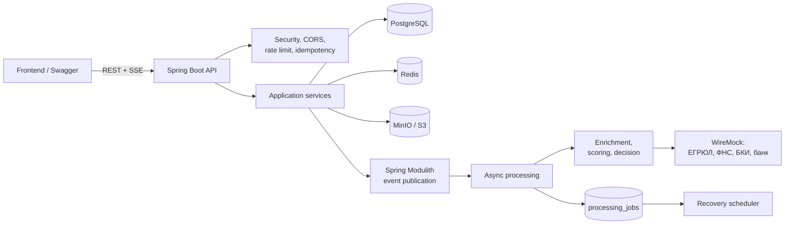

# Умный кредитный кабинет предпринимателя

Кредитный конвейер для малого и микробизнеса: заявка, сбор данных, скоринг,
решение, контрпредложения, ручное рассмотрение, загрузка документов и имитация выдачи.
Веб-кабинет с двумя ролями: предприниматель и сотрудник банка.

Подробный гид для фронтенд-разработчика: [BACKEND_FOR_FRONTEND.md](BACKEND_FOR_FRONTEND.md).
Устройство базы данных и демо-данные: [docs/DATABASE.md](docs/DATABASE.md).

## Что умеет проект

- Создание и ведение заявки: `DRAFT -> ENRICHMENT -> SCORING -> DECISION -> результат`.
- Подбор кредитного продукта по цели, сумме и сроку.
- Предодобренное предложение по ИНН.
- Сбор данных из ЕГРЮЛ, ФНС, БКИ и внутренних данных банка (WireMock).
- Скоринг до 10 факторов, грейды A/B/C/D, стоп-факторы.
- Автоматическое одобрение, контрпредложения и отказ.
- Ручное рассмотрение менеджером: одобрение, контрпредложение, запрос документов, отказ.
- Загрузка документов в MinIO/S3 с проверкой типа и сигнатуры файла.
- Список и скачивание загруженных документов.
- Живой трекер статусов через SSE и история событий (timeline).
- Объяснение решения: факторы, следующие шаги и опциональное резюме от LLM.
- Идемпотентность POST-запросов через `Idempotency-Key` и Redis.
- Rate limiting по IP.
- Устойчивая асинхронная обработка: retry, exponential backoff, DLQ и восстановление зависших заявок.
- S3+DB компенсация: объект удаляется при ошибке загрузки или откате транзакции.

## Стек

- Kotlin 2.1 / Java 21 / Spring Boot 3.5
- PostgreSQL 16, Redis 7, MinIO (S3)
- Spring Modulith Events, Spring Security (Basic Auth)
- Spring Data JPA / Hibernate; валидация в сервисах
- Resilience4j: retry и circuit breaker для внешних источников
- Bucket4j: rate limiting
- WireMock для моков ЕГРЮЛ, ФНС, БКИ и банка
- Testcontainers для интеграционного теста контекста
- Springdoc OpenAPI / Swagger UI

## Архитектура



### Слои

```text
api/            REST-контроллеры, DTO запросов и ответов, обработка ошибок
service/        бизнес-логика: заявки, решения, документы, события, SSE
service/processing/  асинхронный конвейер, retry, DLQ, восстановление
service/scoring/     скоринг, грейды, офферы, расчёт платежей
domain/         JPA-сущности, статусы, state machine, доменные события
repository/     Spring Data JPA репозитории
integration/    клиенты внешних источников и AI
config/         security, CORS, S3, policy/scorecard, OpenAPI, demo data
fliter/, filter/ servlet-фильтры идемпотентности и rate limiting
listener/       слушатель события отправки заявки
```

### Асинхронный конвейер

1. `POST /api/applications/{id}/submit` переводит заявку в `ENRICHMENT` и публикует `ApplicationSubmittedEvent`.
2. Spring Modulith сохраняет событие в БД (transactional outbox) и передаёт его асинхронному listener.
3. `ApplicationProcessingService` выполняет этапы:
   - сбор данных из внешних источников;
   - стоп-факторы;
   - скоринг;
   - решение и создание офферов.
4. При ошибке создаётся запись в `processing_jobs`, а не пробрасывается исключение из listener.
5. `ProcessingRecoveryScheduler` каждые 30 секунд:
   - повторяет задачи в `PENDING`/`RETRY`;
   - находит заявки, зависшие в промежуточных статусах, и ставит их в очередь.
6. После исчерпания попыток задача попадает в `DEAD_LETTER`; менеджер может посмотреть DLQ и повторить обработку.

### Использованные паттерны

- **Layered architecture** — контроллеры, сервисы, репозитории и доменная модель разделены по пакетам.
- **Repository** — доступ к данным через Spring Data JPA.
- **DTO / Mapper** — API-модели отделены от JPA-сущностей.
- **State Machine** — переходы статусов заявки централизованы в `ApplicationStateMachine`.
- **Event-driven architecture** — обработка запускается доменным событием, а не синхронным вызовом из контроллера.
- **Transactional Outbox** — Spring Modulith хранит события в БД и повторно публикует незавершённые события после рестарта.
- **Retry + Dead Letter Queue** — ошибки обработки сохраняются в `processing_jobs` с backoff и статусом `DEAD_LETTER`.
- **Compensating transaction / Saga-like** — при откате БД-транзакции удаляется уже загруженный S3-объект.
- **Idempotency Key** — повторный POST с тем же `Idempotency-Key` не создаёт дубль.
- **Rate Limiting** — token bucket на IP через Bucket4j.
- **Circuit Breaker + Retry** — Resilience4j защищает от зависаний и временных сбоев внешних источников.
- **Strategy / Adapter** — `EgrulClient` и `DocumentStorage` имеют интерфейсы и заменяемые реализации.
- **Optimistic Locking** — `@Version` в `Application` защищает от конкурентных изменений.
- **SSE** — server-sent events для живого трекера статусов.
- **Global Exception Handler** — единый формат ошибок API.
- **Configuration Properties** — политики скоринга и лимиты вынесены в YAML и переменные окружения.

## Быстрый запуск

### Полный запуск в Docker

```bash
docker compose up --build
```

После старта:

- Веб-кабинет: <http://localhost:3000>
- API: <http://localhost:8080>
- Swagger UI: <http://localhost:8080/swagger-ui.html>
- OpenAPI JSON: <http://localhost:8080/v3/api-docs>
- Моки: <http://localhost:8089>
- MinIO Console: <http://localhost:9001> (`minioadmin` / `minioadmin`)

Остановить:

```bash
docker compose down
```

Остановить и удалить данные PostgreSQL/MinIO:

```bash
docker compose down -v
```

Приложение собирается multi-stage `Dockerfile` (Maven + Java 21) и запускается
в отдельном контейнере. PostgreSQL и Redis имеют healthcheck, поэтому приложение
стартует после их готовности. MinIO и WireMock поднимаются параллельно; bucket
создаётся приложением при первой загрузке документа.

Первая сборка занимает 10–15 минут: Maven скачивает зависимости, `npm ci` —
пакеты фронтенда. Повторные сборки быстрее за счёт кэша BuildKit и слоёв Docker.

### Проверка после запуска

Дождитесь статуса `healthy` у `app`:

```bash
docker compose ps
```

Затем запустите готовую smoke-проверку (Windows PowerShell):

```powershell
powershell -ExecutionPolicy Bypass -File .\scripts\smoke.ps1
```

Скрипт проверяет:

- доступность веб-кабинета на `http://localhost:3000`;
- `GET /actuator/health` (PostgreSQL + Redis);
- загрузку продуктов и компаний;
- предодобренное предложение по ИНН `7704983159`;
- что клиент получает `403` на `/api/manager/**`;
- очередь ручной проверки для менеджера;
- полный сценарий: создание заявки → согласия → отправка → скоринг →
  решение → объяснение → предложения → история событий.

Ожидаемый финал:

```text
Успешно: 15
Ошибок:  0
```

Если нужен только API-сценарий без веба, есть `scripts/demo-run.sh`
(требуется bash + curl + perl).

Ручной чек-лист в браузере:

1. Откройте <http://localhost:3000/login> и войдите как «Предприниматель».
2. Пройдите `/apply` с ИНН `7704983159` (одобрение) или `7703168426`
   (контрпредложение). После отправки откроется трекер заявки.
3. Дождитесь решения: статус, факторы скоринга, объяснение и предложения
   обновляются автоматически (SSE + запасной polling).
4. Примите предложение и подпишите договор — заявка перейдёт в `FUNDED`.
5. Выйдите и войдите как «Сотрудник банка», откройте `/manager`:
   заявка с ИНН `7722085341` должна быть в очереди ручной проверки.
6. Откройте карточку заявки, примите решение (одобрить / другие условия /
   запросить документы / отказать).
7. Проверьте `/manager/dlq` — сбои обработки и кнопку повторного запуска.
8. Откройте Swagger UI: <http://localhost:8080/swagger-ui.html>.

Демо-ИНН и ожидаемые решения — в разделе [«Демо-ИНН»](#демо-инн) ниже.

### Чистая база и Flyway

Схема и демо-данные создаются миграциями `V1`–`V5` при старте приложения.
Hibernate работает в режиме `ddl-auto: validate` и только проверяет схему.

Если база осталась от старой версии проекта и миграции не сходятся, поднимите
стек с нуля (демо-данные восстановятся автоматически):

```bash
docker compose down -v
docker compose up -d --build
```

`baseline-on-migrate: true` позволяет применить миграции к уже существующей базе,
где ещё нет таблицы `flyway_schema_history`. Если старая схема создавалась
вручную и отличается от `V1`, надёжнее удалить volume и начать с чистой БД.

Подробности по таблицам, view и проверочным SQL — в [docs/DATABASE.md](docs/DATABASE.md).

### Локальная разработка

1. Поднять инфраструктуру:

```bash
docker compose up -d postgres redis mocks minio
```

2. Запустить приложение локально:

```bash
./mvnw spring-boot:run
```

Для Windows PowerShell:

```powershell
.\mvnw.cmd spring-boot:run
```

Схема БД и демо-данные создаются миграциями Flyway при старте, Hibernate только проверяет схему (`ddl-auto: validate`). Таблицы, миграции и демо-заявки описаны в [docs/DATABASE.md](docs/DATABASE.md).

## Веб-кабинет

Код лежит в [`web/`](web): Next.js 16, React 19, TypeScript, Tailwind CSS, shadcn/ui,
TanStack Query, React Hook Form и Zod. В Docker поднимается сервисом `web` на порту 3000
и проксирует `/api/*` на `app:8080`, поэтому CORS и отдельный адрес API браузеру не нужны.

Интеграция с backend:

- `web/api/*` повторяет DTO из `src/main/kotlin/com/alfabank/credit/dto` и контракт
  из [BACKEND_FOR_FRONTEND.md](BACKEND_FOR_FRONTEND.md);
- Basic Auth подставляется на клиенте: роль `client` или `manager`
  (логин/пароль по умолчанию — `client:password` и `manager:password`);
- в Docker `NEXT_PUBLIC_USE_MOCKS=false`, поэтому фронт ходит в реальный backend;
- для локального фронта без backend можно включить встроенные моки:
  `NEXT_PUBLIC_USE_MOCKS=true` в `web/.env.local`;
- SSE-трекер использует `/api/applications/{id}/stream`, при недоступности
  стрима остаётся polling.

Версии Node.js, npm-пакетов и базовых образов зафиксированы; см.
[docs/DEPENDENCIES.md](docs/DEPENDENCIES.md).

Вход демо-режимом на `/login`, без пароля: роль «Предприниматель» (`client`) или
«Сотрудник банка» (`manager`). Фронт подставляет Basic Auth нужной роли сам.

Клиент:

- главная с предварительным лимитом по ИНН, калькулятором и подбором продукта;
- квиз из трёх вопросов (`/quiz`), результат сразу открывает заявку с нужными параметрами;
- заявка в четыре шага (`/apply`): ИНН с проверкой контрольной суммы и данными из ЕГРЮЛ,
  цель и продукт, сумма, срок и залог, проверка условий и согласия;
- трекер заявки (`/applications/{id}`): этапы, история, обновление по SSE с запасным опросом,
  объяснение решения, факторы оценки, 1–3 предложения с платежом и переплатой,
  принятие, подписание и выдача, загрузка документов по запросу банка.

Сотрудник банка:

- очередь ручной проверки (`/manager`), долго ждущие заявки подсвечены;
- все заявки (`/manager/applications`);
- карточка заявки: данные компании, долговая нагрузка, факторы оценки, ИИ-резюме,
  документы, история и форма решения: одобрить, другие условия, запросить документы, отказать;
- сбои обработки (`/manager/dlq`) с повторным запуском.

Для демо удобно открыть два окна рядом: клиент и сотрудник банка.

Локальная разработка фронта (нужен Node.js 24):

```bash
cd web
cp .env.example .env.local
npm ci
npm run dev
```

`NEXT_PUBLIC_USE_MOCKS=true` в `.env.local` запускает фронт без бэкенда на встроенных моках
с теми же демо-ИНН. Проверки: `npm run typecheck`, `npm run lint`, `npm run build`.

## Авторизация

Basic Auth:

| Логин | Пароль | Роль |
|---|---|---|
| `client` | `password` | CLIENT |
| `manager` | `password` | MANAGER |

Клиент видит только свои заявки, менеджер — все. SMS/OTP и вход по телефону
намеренно не реализованы: по условиям кейса способ авторизации выбирает команда.

Публичные эндпоинты: `/api/quiz/**`, `/api/offers/**`, `/api/products/**`,
`/swagger-ui/**`, `/v3/api-docs/**`. Остальные требуют аутентификации.
`/api/manager/**` доступны только роли `MANAGER`.

## API

### Клиентские и общие

| Метод | Путь | Назначение |
|---|---|---|
| `GET` | `/api/companies` | Список компаний (нужен `companyId`) |
| `GET` | `/api/companies/lookup?inn=` | Карточка компании из БД или ЕГРЮЛ-мока |
| `GET` | `/api/products` | Кредитные продукты (нужен `productId`) |
| `POST` | `/api/quiz/recommend` | Подобрать до 2 продуктов по цели, сумме и сроку |
| `GET` | `/api/offers/preapproved?inn=` | Предодобренное предложение по ИНН |
| `POST` | `/api/applications` | Создать черновик заявки |
| `GET` | `/api/applications` | Список заявок с пагинацией |
| `GET` | `/api/applications/{id}` | Карточка заявки |
| `POST` | `/api/applications/{id}/consents` | Подписать согласия БКИ и ПДн |
| `POST` | `/api/applications/{id}/submit` | Отправить заявку в конвейер |
| `GET` | `/api/applications/{id}/timeline` | История событий |
| `GET` | `/api/applications/{id}/stream` | SSE-поток статусов |
| `GET` | `/api/applications/{id}/score` | Балл, грейд и факторы |
| `GET` | `/api/applications/{id}/offers` | Предложения и контрпредложения |
| `GET` | `/api/applications/{id}/explanation` | Объяснение решения |
| `POST` | `/api/applications/{id}/documents` | Загрузить документ (multipart) |
| `GET` | `/api/applications/{id}/documents` | Список документов заявки |
| `GET` | `/api/applications/{id}/documents/{documentId}/download` | Скачать документ |
| `POST` | `/api/applications/{id}/accept-offer` | Принять предложение |
| `POST` | `/api/applications/{id}/sign` | Имитация подписания и выдачи |

### Менеджер

| Метод | Путь | Назначение |
|---|---|---|
| `GET` | `/api/manager/applications/pending` | Очередь ручного рассмотрения |
| `POST` | `/api/manager/applications/{id}/decision` | Решение менеджера |
| `GET` | `/api/manager/dlq` | Очередь недоставленных событий |
| `POST` | `/api/manager/dlq/{applicationId}/retry` | Повторить обработку из DLQ |

Полные примеры запросов и ответов — в [BACKEND_FOR_FRONTEND.md](BACKEND_FOR_FRONTEND.md).

## Статусы

```text
DRAFT -> ENRICHMENT -> SCORING -> DECISION -> APPROVED / COUNTER_OFFER / REJECTED / MANUAL_REVIEW
MANUAL_REVIEW -> APPROVED / COUNTER_OFFER / REJECTED / NEEDS_MORE_INFO / CLOSED
NEEDS_MORE_INFO -> MANUAL_REVIEW / CLOSED
APPROVED / COUNTER_OFFER -> SIGNING -> FUNDED
REJECTED / FUNDED / CLOSED — терминальные
```

`SUBMITTED`, `CANCELLED` и `EXPIRED` оставлены в enum только для чтения старых строк БД.
`SUBMITTED` поддерживается при resume: при обработке он переводится в `ENRICHMENT`.
`CANCELLED` и `EXPIRED` из state machine удалены.

## Скоринг и решение

- До 10 факторов, балл `600 + 2 × сумма факторов`, шкала 0–1000.
- Грейды: `A >= 700`, `B >= 600`, `C >= 500`, `D < 500`.
- Лимиты без залога: A — 40% выручки, B — 30%, C — 20%, D — 10%.
- Ставка: базовая ставка продукта + надбавка грейда (A 0, B +0.5, C +1.0, D +4.5 п.п.).
- Стоп-факторы: ликвидация, приостановка счетов, просрочка 90+ дней.
- Недоступный источник или сумма > 10 млн — ручное рассмотрение.
- При превышении лимита формируются три варианта:
  - `LIMIT` — сумма в пределах лимита;
  - `GUARANTEE` — полная сумма под поручительство по ставке 19.5%;
  - `COLLATERAL` — промежуточная сумма под залог со ставкой продукта −2.0 п.п. и сроком +6 месяцев.
- Для одобрения создаётся оффер `REQUESTED`.

Факторы хранятся в `scoringDetails` как JSON-строка с кодами причин R01–R06; старый формат
`Название (баллы)` продолжает читаться. Для фронтенда предпочтителен структурированный
ответ `GET /api/applications/{id}/score`, а не парсинг `scoringDetails`.

## Надёжность и восстановление

- Таблица `processing_jobs` со статусами `PENDING`, `RETRY`, `DONE`, `DEAD_LETTER`.
- Exponential backoff: 30 секунд, удвоение, максимум 3600 секунд.
- Максимум 5 попыток по умолчанию.
- Планировщик каждые 30 секунд, пакет до 20 задач.
- Заявка считается зависшей, если провела в `SUBMITTED`/`ENRICHMENT`/`SCORING`/`DECISION` больше 120 секунд.
- При ошибке listener не пробрасывает исключение: событие Modulith завершается, а задача сохраняется через `REQUIRES_NEW`.
- `ApplicationProcessingService.process` выполняется в отдельной транзакции `REQUIRES_NEW`.
- Resume поддерживается с `ENRICHMENT`, `SCORING` и `DECISION`. Внешние источники перечитываются, сохранённые `riskScore`/`scoringDetails` переиспользуются.
- S3-объект удаляется:
  - если загрузка не удалась;
  - если транзакция с сохранением документа откатилась.

Посмотреть очередь:

```sql
SELECT application_id, status, attempts, last_error, next_attempt_at
FROM processing_jobs
ORDER BY updated_at DESC;
```

## Конфигурация

| Переменная | По умолчанию | Назначение |
|---|---|---|
| `APP_MOCKS_URL` | `http://localhost:8089` | Адрес WireMock-моков |
| `APP_S3_ENDPOINT` | `http://localhost:9000` | S3/MinIO endpoint |
| `APP_S3_ACCESS_KEY` | `minioadmin` | S3 access key |
| `APP_S3_SECRET_KEY` | `minioadmin` | S3 secret key |
| `APP_PROCESSING_RETRY_INTERVAL_MS` | `30000` | Интервал планировщика |
| `APP_PROCESSING_MAX_ATTEMPTS` | `5` | Максимум попыток обработки |
| `APP_PROCESSING_RETRY_BASE_SECONDS` | `30` | Базовая задержка retry |
| `APP_PROCESSING_RETRY_MAX_SECONDS` | `3600` | Максимальная задержка retry |
| `APP_PROCESSING_STUCK_AFTER_SECONDS` | `120` | Порог зависания заявки |
| `APP_PROCESSING_BATCH_SIZE` | `20` | Размер пакета восстановления |
| `APP_RATE_LIMIT_CAPACITY` | `60` | Ёмкость rate limit |
| `APP_RATE_LIMIT_REFILL_PER_MINUTE` | `60` | Пополнение rate limit в минуту |
| `APP_CORS_ALLOWED_ORIGINS` | `http://localhost:3000,http://localhost:5173,http://localhost:4200` | Разрешённые origins |
| `APP_AI_BASE_URL` | `http://localhost:11434` | OpenAI-совместимый endpoint |
| `APP_AI_API_KEY` | пусто | API-ключ AI |
| `APP_AI_MODEL` | `qwen2.5:7b` | Модель AI |
| `APP_AI_TIMEOUT_SECONDS` | `10` | Таймаут AI |

## Демо-ИНН

| ИНН | Сценарий |
|---|---|
| `7704983159` | Грейд A, одобрение |
| `7703168426` | Грейд C, контрпредложение |
| `7729501760` | Грейд D, отказ |
| `7722085341` | Ошибка БКИ, ручное рассмотрение |
| `7731497609` | ФНС временно недоступна, затем успех |
| `7736150978` | Ликвидированная компания, стоп-фактор |

Ещё семь клиентов и итоги по всем демо-заявкам описаны в [docs/DATABASE.md](docs/DATABASE.md).

## Тесты

Для тестов нужен запущенный Docker: интеграционный контекст поднимает PostgreSQL
и Redis через Testcontainers.

```bash
./mvnw test
```

Если wrapper не может скачать Maven:

```powershell
mvn -B -ntp clean test
```

Проверено: 32 теста, 0 failures/errors. Покрыты:

- основные демо-ИНН;
- границы DTI;
- стоп-факторы;
- контрпредложения;
- расчёт платежа и переплаты;
- переходы статусов;
- resume с `SCORING`;
- retry, DLQ и replay;
- удаление S3-объекта после ошибки БД;
- список и скачивание документов, включая проверку принадлежности заявке;
- переход `SCORING -> MANUAL_REVIEW`;
- интеграционный контекст с PostgreSQL и Redis через Testcontainers.

В конце тестов может появляться предупреждение Surefire
`Surefire is going to kill self fork JVM...` — это особенность остановки Testcontainers,
на результат тестов оно не влияет.

## ИИ-объяснения

`AiAssistantClient` использует OpenAI-совместимый `/v1/chat/completions`
(подходит Ollama и внешние провайдеры). Настройки:

```yaml
app:
  ai:
    base-url: ${APP_AI_BASE_URL:http://localhost:11434}
    api-key: ${APP_AI_API_KEY:}
    model: ${APP_AI_MODEL:qwen2.5:7b}
    timeout-seconds: ${APP_AI_TIMEOUT_SECONDS:10}
```

Если ИИ недоступен или в ответе появляются числа, которых нет во входных данных,
возвращается детерминированный шаблон.

## Ограничения

- MinIO закреплён на amd64-образе; на ARM может потребоваться другая платформа.
- Basic Auth — демонстрационный, без refresh-токенов и полноценного профиля пользователя.
- `/sign` — имитация: реального платежа и подписания нет.
- SSE не заменяет polling после действий менеджера и клиента: эти действия не всегда отправляют SSE-событие.
- Документы сохраняются и отдаются как файлы, но их содержимое не распознаётся (OCR) и не проверяется автоматически.
- Нет endpoint'ов редактирования, отмены и удаления заявки.

## Устранение неполадок

**`docker compose` не запускается: cannot connect to the Docker daemon.**
Запустите Docker Desktop и дождитесь статуса Engine running.

**Порт занят (`5432`, `6379`, `8080`, `8089`, `9000`, `3000`).**
Остановите локальный PostgreSQL/Redis или измените левую часть порта в
`docker-compose.yaml`, например `"8081:8080"`.

**`app` перезапускается, в логах Flyway или `Schema-validation`.**
Посмотрите причину:

```bash
docker compose logs app --tail 200
```

Если база осталась от старой версии схемы — `docker compose down -v` и
`docker compose up -d --build`.

**`mvnw` не может скачать Maven (timeout).**
Wrapper скачивает дистрибутив Maven с Maven Central. Если сеть недоступна,
используйте установленный Maven 3.9.6+:

```powershell
mvn -version
mvn -B -ntp clean test
```

Для сборки Docker локальный Maven не нужен — Maven уже есть в образе.

**Maven в Docker падает на скачивании зависимостей.**
Это сетевой сбой Maven Central. Перезапустите сборку:

```bash
docker compose build app
```

В `Dockerfile` включены повторы (`maven.wagon.http.retryHandler.count=5`) и
кэш `~/.m2` через BuildKit. Если сеть нестабильна, повторите команду — уже
скачанные артефакты берутся из кэша.

**`web` отвечает 500, а backend работает.**
Проверьте, что контейнер `app` healthy, и что `BACKEND_URL` при сборке `web`
указан как `http://app:8080`:

```bash
docker compose build web
docker compose logs web --tail 100
```

**Фронт открывается, но данные не грузятся.**
В Docker должен быть `NEXT_PUBLIC_USE_MOCKS=false` (задан в `docker-compose.yaml`).
Если фронт запускался локально с `.env.local`, проверьте эту переменную и
`BACKEND_URL=http://localhost:8080`.

**SSE-трекер не обновляется мгновенно.**
Это не ошибка: фронт автоматически опрашивает заявку каждые 3 секунды, а при
открытом SSE — реже. SSE-события приходят на изменения статуса.
