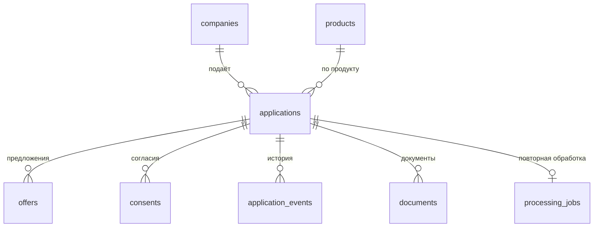

# База данных

PostgreSQL 16. Схема и данные создаются миграциями Flyway при старте приложения, руками ничего запускать не нужно. Hibernate работает в режиме `validate`: он только проверяет, что таблицы совпадают с сущностями, и сам схему не меняет.

## Как посмотреть

```bash
docker compose up -d --build
docker exec -it alfa_credit_db psql -U alfa_admin -d alfa_credit
```

Внутри `psql`:

```sql
SELECT inn, company, product, status, risk_score, grade, offers FROM v_applications_overview ORDER BY created_at;
SELECT * FROM v_companies_risk ORDER BY inn;
SELECT "timestamp", event_type, actor, description FROM v_application_timeline WHERE inn = '7703168426' ORDER BY "timestamp";
```

Начать с чистой базы:

```bash
docker compose down -v
docker compose up -d --build
```

## Миграции

| Файл | Что делает |
|---|---|
| `V1__init_schema.sql` | Таблицы, ключи и связи |
| `V2__demo_companies.sql` | Семь синтетических клиентов из набора Марины |
| `V3__reference_data.sql` | Кредитные продукты, шесть демо-компаний под моки, два менеджера |
| `V4__demo_applications.sql` | 13 готовых заявок с офферами, согласиями и историей событий |
| `V5__overview_views.sql` | Представления для просмотра данных |

Все вставки написаны так, что повторный запуск ничего не дублирует. Уже применённые миграции менять нельзя: Flyway сверяет контрольные суммы и не даст приложению стартовать. Новые изменения кладём в следующий номер, `V6__...sql`.

## Таблицы



**companies**: клиенты банка, ИП и юрлица. Регистрации нового клиента в сценарии нет, поэтому все компании заранее лежат в базе.

| Поле | Смысл |
|---|---|
| `inn`, `ogrn` | ИНН (10 цифр у ООО, 12 у ИП) и ОГРН/ОГРНИП, уникальный ключ по ИНН |
| `name`, `director_name` | Название и руководитель |
| `okved`, `okved_description` | Основной вид деятельности, от него зависит отраслевой риск |
| `registration_date` | Дата регистрации, из неё считается возраст бизнеса |
| `category` | Малое или микропредприятие |
| `status` | `active` или `liquidated` |
| `annual_revenue`, `total_debt`, `tax_debt` | Выручка за год, общий долг, налоговый долг, в рублях |
| `bank_relationship_months` | Сколько месяцев компания обслуживается в банке |

При скоринге бэкенд берёт свежие данные из моков ЕГРЮЛ, ФНС, БКИ и банка. Поля в `companies` нужны для карточки клиента и списка компаний, а финансовые показатели совпадают с ответами моков.

**products**: кредитные продукты: оборотный кредит, овердрафт, инвестиционный кредит, кредит с господдержкой. Для каждого задан диапазон суммы и срока и базовая ставка. Ставки взяты с запасом над ключевой ставкой, как сейчас на рынке.

**applications**: заявки.

| Поле | Смысл |
|---|---|
| `company_id`, `product_id` | Кто и на какой продукт подал |
| `requested_amount`, `requested_term_months`, `purpose`, `has_collateral` | Что просит клиент |
| `status` | Этап конвейера, переходы описаны в основном README |
| `risk_score` | Балл скоринга от 0 до 1000 |
| `scoring_details` | Вклад каждого фактора в балл, JSON |
| `approved_amount`, `approved_term_months`, `rejection_reason` | Итог решения |
| `owner_username` | Пользователь, который подал заявку |
| `version` | Защита от одновременного изменения |
| `created_at`, `updated_at` | Когда создана и когда менялась |

**offers**: предложения по заявке. `REQUESTED` для одобрения на запрошенных условиях, `LIMIT`, `GUARANTEE` и `COLLATERAL` для контрпредложений. Платёж и переплату бэкенд считает на лету по сумме, сроку и ставке.

**consents**: согласия клиента: `BKI` на запрос кредитной истории и `PD` на обработку персональных данных. Без обоих заявку нельзя отправить.

**application_events**: история заявки для трекера: кто и когда что сделал.

**documents**: загруженные файлы. Сами файлы лежат в MinIO, в базе их имя, тип, размер и хэш.

**processing_jobs**: задачи на повторную обработку, если внешний источник не ответил. После пяти попыток задача уходит в `DEAD_LETTER`, менеджер может перезапустить её вручную.

**event_publication** и **event_publication_archive**: служебные таблицы Spring Modulith. Событие об отправке заявки сначала записывается сюда, поэтому не теряется при перезапуске.

**managers**: справочник кредитных специалистов. Вход сейчас идёт через демо-учётки `client` и `manager`, таблица пригодится, когда заявки начнут назначаться на конкретного человека.

## Демо-данные

13 компаний и по одной заявке на каждую. На этих же ИНН работают моки, поэтому новую заявку можно подать по любому из них и получить тот же исход.

| ИНН | Компания | Продукт и сумма | Балл | Итог |
|---|---|---|---|---|
| 7704983159 | ООО «ТехноПрогресс» | оборотный, 10 млн | 800, A | выдано |
| 7703168426 | ООО «Хлебный двор» | оборотный, 5 млн | 580, C | три контрпредложения |
| 7729501760 | ООО «СтройМаркет» | оборотный, 3 млн | 200, D | отказ |
| 772584916321 | ИП Смирнов Андрей Викторович | овердрафт, 1,5 млн | 770, A | одобрено |
| 7703849263 | ООО «МедТехСервис» | оборотный, 12 млн | 640, B | ручное рассмотрение, сумма больше 10 млн |
| 7709518363 | ООО «ГастроНомерОдин» | оборотный, 3 млн | 570, C | три контрпредложения |
| 501274839072 | ИП Козлова Екатерина Сергеевна | оборотный, 1 млн | 590, C | три контрпредложения |
| 7715834021 | ООО «Квантум Софт» | оборотный, 1,5 млн | 400, D | отказ |
| 7720496138 | ООО «ОптТоргСнаб» | оборотный, 5 млн | 420, D | отказ |
| 5047182637 | ООО «ЛогистикПро» | оборотный, 8 млн | 800, A | выдано |
| 7722085341 | ООО «Северный ветер» | оборотный, 5 млн | — | БКИ не ответил, ручное рассмотрение |
| 7731497609 | ООО «Лесная поляна» | оборотный, 3 млн | 770, A | ФНС ответила с третьей попытки, одобрено |
| 7736150978 | ООО «Старый склад» | оборотный, 1 млн | — | компания ликвидирована, отказ без скоринга |

Все компании, ИНН и цифры выдуманы. ИНН и ОГРН проходят проверку контрольных сумм, но не принадлежат реальным организациям, насколько это можно проверить.

Заявки в `V4` получены прогоном настоящего конвейера, а не написаны руками: баллы, офферы и события в них такие же, как при живой работе. Прогнать заново можно скриптом:

```bash
bash scripts/demo-run.sh
```

Скрипт подаёт заявку по каждому ИНН через API, ждёт решения и печатает статус и балл. Нужны `curl` и `perl`, они есть в Git Bash, Linux и macOS.

## Что изменилось по сравнению с файлом Марины

- ИНН первых трёх клиентов заменены: 7707083893 и 7710140679 принадлежат реальным банкам, у 7712345678 неверная контрольная сумма. Остальные ИНН тоже сделаны синтетическими.
- Колонки называются так, как в схеме: `requested_amount` и `requested_term_months` вместо `amount` и `term`, у каждой записи есть `id`.
- Отдельных таблиц `scoring_results` и `credit_decisions` нет: балл и факторы лежат в `applications`, предложения в `offers`.
- Баллы пересчитаны по текущей формуле `600 + 2 × сумма баллов факторов`, поэтому часть цифр в комментариях к старому файлу не совпадает.

## Что можно добавить дальше

- Историю финансов по годам (`company_financials`), если понадобится показывать динамику выручки, а не одну цифру.
- Связку пользователей с компаниями (`users`, `company_users`), когда вместо двух демо-учёток появится нормальный вход.
- Назначение заявки на менеджера из `managers` и время, которое заявка провела на каждом этапе, для отчёта по срокам.
